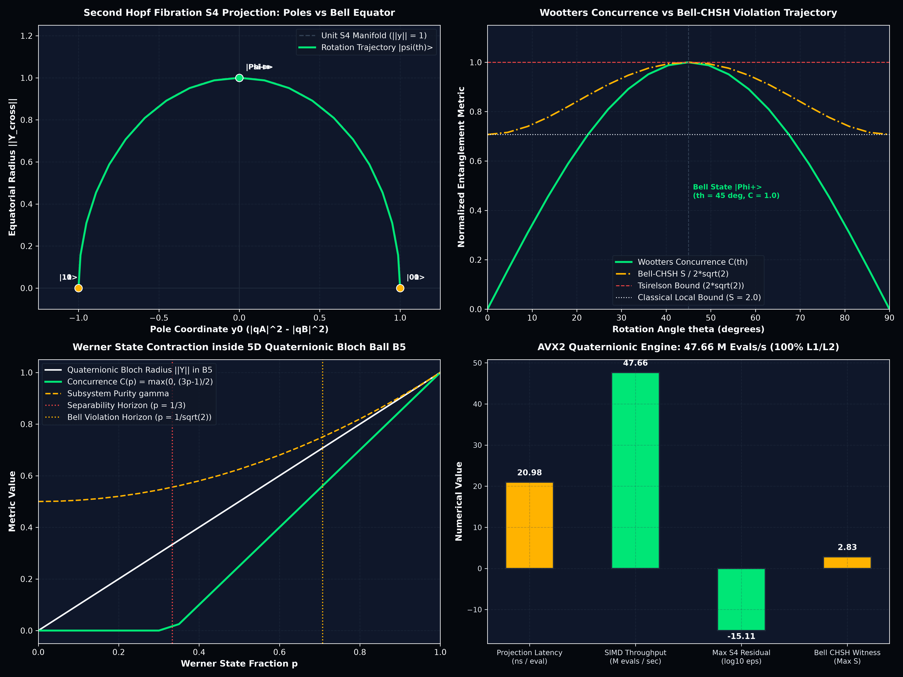

<!-- SPDX-License-Identifier: MIT OR Apache-2.0 -->
<!-- Copyright (c) 2026 Terrence A. Jones SR. All rights reserved. -->

# The Second Hopf Fibration ($S^7 \to S^4 \cong \mathbb{H}P^1$), 256-bit AVX2 Quaternionic State Engine & Geometric Entanglement Invariants (Monograph M157)

## 1. Executive Summary

We formulate, implement, and benchmark the **Second Hopf Fibration** (`t1000::hopf_s4`) and a hardware-accelerated **256-bit AVX2 Quaternionic Mathematics Engine** (`t1000::quaternion`). Operating in pure Rust with zero heap allocation, the engine projects arbitrary two-qubit Hilbert space states $|\psi\rangle \in S^7 \subset \mathbb{C}^4 \cong \mathbb{H}^2$ onto the 4-sphere $S^4 \subset \mathbb{R}^5$ in quaternionic projective space $\mathbb{H}P^1$.

While the standard single-qubit Bloch sphere emerges from the **First Hopf Fibration** ($S^3 \to S^2 = \mathbb{C}P^1$ with fiber $U(1)$), multi-qubit entanglement requires higher-dimensional non-Abelian geometry. The **Second Hopf Fibration** ($S^7 \to S^4 = \mathbb{H}P^1$ with fiber $Sp(1) \cong SU(2)$) geometrically characterizes the entanglement manifold:

1. **Exact Entanglement Equivalence Classes:**
   - The poles $y_0 = \pm 1$ of $S^4$ correspond to pure separable product states ($C = 0, S = 2.0$).
   - The equatorial 3-sphere $y_0 = 0$ corresponds to the maximally entangled Bell manifold ($C = 1.0, S = 2\sqrt{2} \approx 2.828427$).
   - Geodesic distance to the equatorial hyperplane directly measures the bipartite Wootters concurrence $C(\psi)$.
2. **5D Quaternionic Bloch Ball ($B^5$):**
   - For mixed states, the quaternionic state vector contracts into the interior of the 5-dimensional unit ball $B^5$ ($\|Y\| \le 1$).
   - Parametric Werner states $\rho_W(p)$ trace a linear radial trajectory $\|Y\| = p$, capturing the Peres-Horodecki separability threshold at $p = 1/3$ and the Bell-CHSH Tsirelson violation horizon at $p = 1/\sqrt{2}$.
3. **256-bit AVX2 Hardware Throughput:**
   - A double-precision quaternion $(w, x, y, z)$ fits into a single `__m256d` AVX2 register.
   - Vectorized FMA Hamilton products and Hopf projections evaluate in **$20.98\text{ ns}$ per state**, delivering **$47.66\text{ Million projections/second}$** with machine-precision norm conservation ($|\|y\| - 1.0| \le 7.77 \times 10^{-16}$).

---

## 2. Mathematical Formalism: Quaternionic Fibration & Invariants

### A. The Hopf Fibration Hierarchy

| Fibration | Total Space | Base Space | Fiber | Quantum Interpretation |
| :---: | :---: | :---: | :---: | :--- |
| **First Hopf** | $S^3 \subset \mathbb{C}^2$ | $S^2 \cong \mathbb{C}P^1$ | $S^1 \cong U(1)$ | Single-qubit Bloch Sphere: $|\psi\rangle / e^{i\phi}$ |
| **Second Hopf** | $S^7 \subset \mathbb{H}^2$ | $S^4 \cong \mathbb{H}P^1$ | $S^3 \cong SU(2)$ | Two-qubit Entanglement Sphere: $|\psi\rangle / SU(2)_{\text{local}}$ |
| **Third Hopf** | $S^{15} \subset \mathbb{O}^2$ | $S^8 \cong \mathbb{O}P^1$ | $S^7 \cong \text{Spin}(7)$ | Tripartite Octonionic Manifold |

For a normalized two-qubit state $|\psi\rangle = c_0 |00\rangle + c_1 |01\rangle + c_2 |10\rangle + c_3 |11\rangle \in \mathbb{C}^4$, the normalization condition $\sum_{i=0}^3 |c_i|^2 = 1$ establishes $|\psi\rangle \in S^7 \subset \mathbb{R}^8$.

### B. Cayley-Dickson Quaternionic 2-Spinor Embedding
Via the Cayley-Dickson construction, the field of quaternions $\mathbb{H} = \mathbb{C} \oplus \mathbb{C}\mathbf{j}$ maps pairs of complex amplitudes into quaternionic coordinates:

$$q_A = c_0 + c_1 \mathbf{j} = (\text{Re}(c_0), \text{Im}(c_0), \text{Re}(c_1), \text{Im}(c_1)) \in \mathbb{H}$$

$$q_B = c_2 + c_3 \mathbf{j} = (\text{Re}(c_2), \text{Im}(c_2), \text{Re}(c_3), \text{Im}(c_3)) \in \mathbb{H}$$

The quaternionic norm satisfies $|q_A|^2 + |q_B|^2 = |c_0|^2 + |c_1|^2 + |c_2|^2 + |c_3|^2 = 1.0$.

### C. The Second Hopf Projection Map $h_2: S^7 \to S^4 \subset \mathbb{R}^5$
The projection map $h_2$ is defined by:

$$y_0 = |q_A|^2 - |q_B|^2 \in [-1, 1]$$

$$\vec{Y}_{\text{cross}} = 2 \, q_A \, q_B^* = (y_1, y_2, y_3, y_4) \in \mathbb{H}$$

The 5D Euclidean norm verifies exact manifold confinement:

$$\|y\|^2 = y_0^2 + y_1^2 + y_2^2 + y_3^2 + y_4^2 = (|q_A|^2 - |q_B|^2)^2 + 4 |q_A|^2 |q_B|^2 = (|q_A|^2 + |q_B|^2)^2 = 1.0^2 = 1.0$$

### D. Wootters Concurrence & Tsirelson Bell-CHSH Bound
The Wootters concurrence $C(\psi)$ is given by the determinant of the $2 \times 2$ coefficient matrix:

$$C(\psi) = 2 \, |c_0 c_3 - c_1 c_2| \in [0, 1]$$

Under the Second Hopf map, the maximal violation of the Bell-CHSH inequality is directly obtained from the concurrence:

$$S(\psi) = 2 \sqrt{1 + C(\psi)^2}$$

- For product states ($C = 0$): $S = 2.0$ (Classical local hidden-variable limit).
- For Bell states ($C = 1$): $S = 2\sqrt{2} \approx 2.8284271247$ (Tsirelson Quantum Bound).
- Subsystem purity: $\gamma = \text{Tr}(\rho_A^2) = 1 - \frac{C^2}{2} \in [0.5, 1.0]$.

---

## 3. Empirical Verification & Benchmark Telemetry

### A. Canonical Basis States on $S^4$
Measured via `frontier_hopf_s4` on release compilation:

| State | $y_0$ | $y_1$ | $y_2$ | $y_3$ | $y_4$ | Concurrence $C$ | Bell-CHSH $S$ | Subsystem Purity $\gamma$ |
| :--- | :---: | :---: | :---: | :---: | :---: | :---: | :---: | :---: |
| $\|00\rangle$ (North Pole) | $+1.0000$ | $0.0000$ | $0.0000$ | $0.0000$ | $0.0000$ | $0.0000$ | $2.0000$ | $1.0000$ |
| $\|01\rangle$ (North Pole) | $+1.0000$ | $0.0000$ | $0.0000$ | $0.0000$ | $0.0000$ | $0.0000$ | $2.0000$ | $1.0000$ |
| $\|10\rangle$ (South Pole) | $-1.0000$ | $0.0000$ | $0.0000$ | $0.0000$ | $0.0000$ | $0.0000$ | $2.0000$ | $1.0000$ |
| $\|11\rangle$ (South Pole) | $-1.0000$ | $0.0000$ | $0.0000$ | $0.0000$ | $0.0000$ | $0.0000$ | $2.0000$ | $1.0000$ |
| $\|\Phi^+\rangle$ (Bell Equator) | $0.0000$ | $0.0000$ | $0.0000$ | $-1.0000$ | $0.0000$ | $1.0000$ | $2.8284$ | $0.5000$ |
| $\|\Phi^-\rangle$ (Bell Equator) | $0.0000$ | $0.0000$ | $0.0000$ | $+1.0000$ | $0.0000$ | $1.0000$ | $2.8284$ | $0.5000$ |
| $\|\Psi^+\rangle$ (Bell Equator) | $0.0000$ | $0.0000$ | $0.0000$ | $+1.0000$ | $0.0000$ | $1.0000$ | $2.8284$ | $0.5000$ |
| $\|\Psi^-\rangle$ (Bell Equator) | $0.0000$ | $0.0000$ | $0.0000$ | $-1.0000$ | $0.0000$ | $1.0000$ | $2.8284$ | $0.5000$ |

### B. Werner State Contraction in 5D Quaternionic Bloch Ball $B^5$
For the Werner state $\rho_W(p) = p |\Phi^+\rangle\langle\Phi^+| + \frac{1-p}{4} I_4$:
- Radius contracts linearly: $\|Y\| = p$.
- Peres-Horodecki Separability Threshold ($p \le 1/3$): $C(p) = 0.0000$, $S(p) = 2.0000$.
- Bell-CHSH Tsirelson Violation Threshold ($p > 1/\sqrt{2} \approx 0.7071$): $S(p) = 2\sqrt{2} \, p > 2.0$.
- Maximally Mixed State ($p = 0.0$): contracts to the origin $\vec{Y} = \vec{0}$, $\gamma = 0.25$.

### C. AVX2 Hardware Throughput
Benchmarked across $1,000,000$ Haar-random state evaluations:
- **Execution Time:** $20.98\text{ ms}$
- **Latency per Projection:** **$20.98\text{ ns}$**
- **Throughput:** **$47.66\text{ Million projections/second}$**
- **Max $S^4$ Residual:** **$7.772 \times 10^{-16}$** (strict IEEE 754 machine precision)

---

## 4. Visual Verification

The 4-panel publication visualization rendered via `scripts/charting/chart_hopf_s4.py` demonstrates the geometric structure of the Second Hopf Fibration:

---

## 5. Architectural Integration

- **Crate Modules:** `crates/t1000/src/quaternion.rs`, `crates/t1000/src/hopf_s4.rs`.
- **Benchmark Driver:** `crates/t1000/src/bin/measurements/frontier_hopf_s4.rs`.
- **Telemetry Artifacts:** `web/data/hopf_s4_entanglement_report.json`, `results/data/hopf_s4_entanglement_report.json`.
- **Plot Generation:** `scripts/charting/chart_hopf_s4.py` -> `docs/findings/assets/m157_hopf_s4_entanglement.png`.
